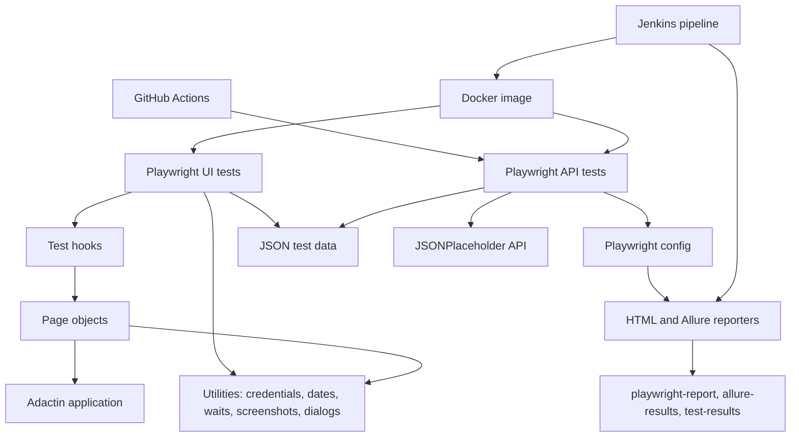

# Adactin Playwright Automation

An end-to-end automation framework for the Adactin hotel booking application, built with JavaScript, Playwright, and the Page Object Model. It also includes JSONPlaceholder API tests, Allure reporting, Docker, and CI/CD examples.

## Framework architecture



See [docs/architecture.md](docs/architecture.md) for component responsibilities and execution details.

## Project structure

```text
pages/                 Page Object Model classes for Adactin
tests/
  positive/            Successful UI and booking scenarios
  negative/            Invalid login and search scenarios
  api/                 JSONPlaceholder GET, POST, PUT, DELETE tests
  helpers/             Shared UI test hooks
test-data/             JSON data for hotel, booking, and API scenarios
utils/                 Credentials, date, wait, screenshot, logging, and dialog helpers
.github/workflows/     GitHub Actions API-test workflow
Dockerfile             Playwright container image
Jenkinsfile            Jenkins pipeline using Docker and Allure
playwright.config.js   Browser, discovery, retry, and reporter configuration
```

The current suite discovers 13 tests (8 UI and 5 API), below the 20-test maximum.

## Requirements and setup

- Node.js and npm
- Docker Desktop for container runs
- A Jenkins agent with Docker access for the Jenkins pipeline
- Adactin test credentials for authenticated UI tests

Install dependencies and the configured Chromium browser:

```powershell
npm ci
npx playwright install chromium
```

Authenticated UI tests read credentials from environment variables; credentials are not stored in the repository or JSON test data. In PowerShell, set them for the current terminal before running the UI suite:

```powershell
$env:ADACTIN_USERNAME = "your-test-username"
$env:ADACTIN_PASSWORD = "your-test-password"
npm test
```

API tests do not need Adactin credentials:

```powershell
npx playwright test tests/api
```

Useful commands:

| Command | Purpose |
| --- | --- |
| `npm test` | Run all UI and API tests |
| `npm run test:headed` | Run tests with a visible browser |
| `npm run test:ui` | Open Playwright UI mode |
| `npm run test:debug` | Run in Playwright debug mode |
| `npm run report` | Open the Playwright HTML report |
| `npm run allure:generate` | Build the Allure report from `allure-results` |
| `npm run allure:open` | Open the generated Allure report |

Playwright automatically waits for locator actions and assertions. `utils/waitUtils.js` provides an explicit visible-element wait for cases that need one; avoid fixed sleeps. UI hooks attach browser console/page errors and capture a screenshot on failure; Playwright's built-in fixtures manage browser and context startup/cleanup. The dialog helpers can accept or dismiss a browser dialog when a test needs to handle one.

For a fresh local Allure report rather than a merge with older runs, clear the previous raw results before testing:

```powershell
Remove-Item -Recurse -Force .\allure-results -ErrorAction SilentlyContinue
npm test
npm run allure:generate
```

## Docker

Build the framework image from the repository root:

```powershell
docker build -t adactin-playwright .
```

After setting the two environment variables above, run the complete suite inside the container:

```powershell
docker run --rm -e ADACTIN_USERNAME -e ADACTIN_PASSWORD adactin-playwright
```

The image uses the Playwright browser image matching the project's Playwright version. Tests run when the container starts.

## CI/CD

### GitHub Actions

`.github/workflows/playwright.yml` runs the API suite on pushes and pull requests to `main`. The hosted runner's access to Adactin can be blocked by the site's anti-bot protection, so the workflow does not claim that external UI tests are reliable there. UI tests remain available locally and in Jenkins.

### Jenkins with Docker

Create a Jenkins Pipeline job pointing at this repository and use the repository `Jenkinsfile`. The pipeline builds the Docker image, runs the complete test suite in the container, generates the Allure report, and archives Playwright/Allure results and failure screenshots.

Before running it:

1. Install the Jenkins Pipeline, Git, Credentials Binding, and Allure Jenkins plugins.
2. Add a Jenkins **Username with password** credential with ID `adactin-credentials`.
3. Use a Jenkins agent with Docker installed and permission to use the Docker daemon.
4. Configure a GitHub webhook to trigger pushes, if push-triggered builds are desired. The Jenkinsfile also schedules a weekday build.

The Adactin site and valid test account must be reachable from the Jenkins agent. A site-side block or invalid account can fail UI tests even when the framework and container build are correct; API tests still target the external JSONPlaceholder service.

## Test data and safety

Hotel and booking inputs live in `test-data/hotel.json` and `test-data/booking.json`; API endpoints, payloads, response expectations, and the post response shape are in `test-data/apiPost.json`. The card and booking details are fictitious test data. Never put real passwords, tokens, or payment details in source files.

Generated reports and test output are ignored by Git. JSONPlaceholder simulates writes: POST, PUT, and DELETE responses do not permanently change its stored records.
