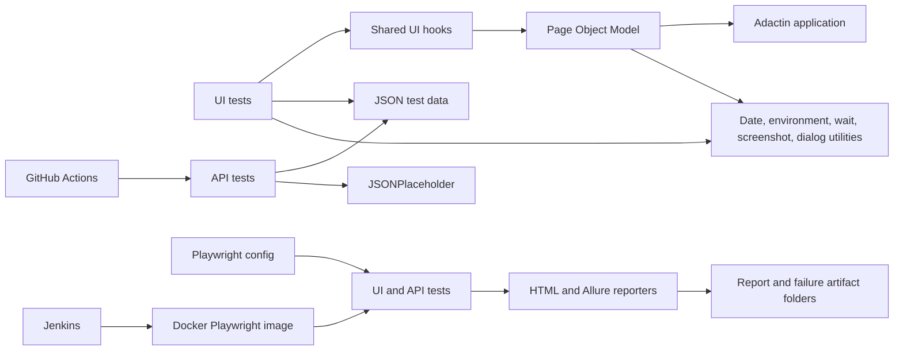

# Framework architecture



## Responsibilities

- **Test suites:** `tests/positive` and `tests/negative` cover UI behavior; `tests/api` covers the JSONPlaceholder API.
- **Hooks:** `tests/helpers/authHooks.js` handles authenticated UI setup and attaches a screenshot when a UI test fails. Playwright owns browser/context creation and cleanup through its built-in fixtures.
- **Page objects:** `pages/` holds page locators and user actions, keeping test cases focused on workflow and assertions.
- **Test data:** `test-data/` stores non-secret hotel, booking, endpoint, payload, expected status/header/time, and response-schema data.
- **Utilities:** `utils/` provides credential validation, date generation, explicit visibility waits, browser console/page-error logs, failure screenshots, and browser-dialog handling. Playwright's locator actions and assertions already auto-wait; no fixed-delay waits are used.
- **Configuration and reporting:** `playwright.config.js` selects Chromium, discovers `.spec.js` tests, configures retry/output behavior, and enables list, HTML, and Allure reporters.
- **CI/CD:** GitHub Actions runs API tests. `Jenkinsfile` builds and runs the Docker image with the full suite, then publishes Allure results and archives generated artifacts.

## Execution and generated files

```text
npm test
  -> Playwright config
  -> UI/API specs
  -> pages, helpers, utilities, and JSON data
  -> Adactin UI / JSONPlaceholder API
  -> playwright-report/, allure-results/, test-results/
```

The `Dockerfile` installs the locked npm dependencies in the official Playwright image and runs `npm test` by default. Jenkins injects Adactin credentials from its credential store; credentials are not copied into the image or checked into the repository.
